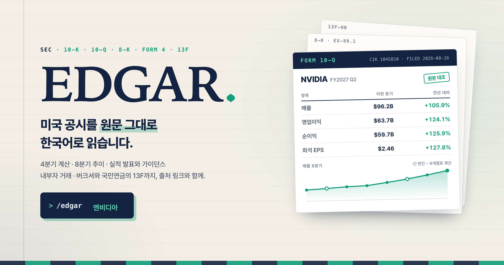

# edgar



> 미국 증권거래위원회(SEC) 공시를 원문 그대로 찾아, 한국어로 읽기 좋게 답합니다.

10-K와 10-Q의 재무 숫자, 회사가 따로 밝히지 않는 4분기 실적, 8-K 실적 발표와 가이던스, 연간 보고서의 위험 요인, 임원들의 주식 거래(Form 4), 버크셔나 국민연금 같은 기관의 보유 종목(13F)까지 하나의 질문으로 꺼냅니다. 모든 숫자에는 근거가 된 공시와 원문 링크가 붙습니다.

---

## 누가 쓰면 좋은가

- 미국 주식을 보는 경영자, 재무 담당자, 투자자
- 증권사 리포트를 기다리지 않고 공시 원문에서 숫자를 직접 확인하고 싶은 분
- 코딩을 몰라도 됩니다. "애플 이번 분기 어땠어?"처럼 한국어로 물으면 됩니다.

## 무엇을 물을 수 있나

| 이렇게 물으면 | 이렇게 답합니다 |
|---|---|
| 엔비디아 이번 분기 실적 어땠어? | 최근 10-Q 기준 매출·영업이익·순이익·EPS를 전년 같은 분기, 직전 분기와 비교합니다 |
| 애플 4분기 실적 알려줘 | 연간 실적(10-K)에서 3분기까지의 누적 실적을 빼 4분기 3개월 값을 구하고, 계산한 값이라고 밝힙니다 |
| 테슬라 5년 매출 추이 | 회사 회계연도 기준으로 표를 만들고 전년 대비 증감률과 CAGR(몇 년 기준인지 함께)을 붙입니다 |
| MSFT 가이던스 뭐라고 했어? | 실적 발표 보도자료(8-K)에서 전망 문구를 찾고, 없으면 없다고 말합니다 |
| 애플 10-K에 중국 리스크 뭐라고 써 있어? | 연간 보고서의 위험 요인 항목에서 해당 대목을 찾아 요약합니다 |
| 'going concern'을 언급한 공시 찾아줘 | SEC 전체 공시 본문을 검색합니다 |
| 테슬라 임원들 주식 팔았어? | 내부자 거래 보고(Form 4)를 읽어 매도자 수, 금액, 사전 계획 매도 비중을 정리합니다 |
| 버크셔가 지난 분기에 뭘 샀어? | 기관 보유 보고(13F)를 직전 분기와 비교해 새로 산 종목, 늘린 종목, 판 종목을 보여 줍니다 |
| 국민연금은 미국 주식 뭘 들고 있어? | 국민연금이 SEC에 낸 13F로 보유 상위 종목과 비중을 보여 줍니다 |

모든 답에는 근거가 된 공시의 종류, 기준 기간, 원문 링크가 붙습니다. 매수나 매도 의견은 내지 않습니다.

## 믿을 수 있나

- **숫자는 SEC가 공개한 XBRL 재무 데이터에서 가져옵니다.** 회사가 공시하면서 항목마다 직접 태그를 붙여 제출한 값입니다.
- **비교는 한 공시 안에서 합니다.** 이번 분기와 전년 같은 분기를 같은 보고서에서 꺼내므로 정정 전 숫자와 정정 후 숫자가 섞이지 않습니다. 비교 기간 값이 처음 공시 때와 다르면 원래 값도 함께 보여 줍니다.
- **계산한 값은 계산했다고 표시합니다.** 4분기 실적, 누적에서 분해한 분기 현금흐름, 마진과 ROE 같은 비율이 여기에 해당합니다. EPS는 분기마다 주식 수가 달라서 빼는 방식으로 구하지 않습니다.
- **없는 숫자는 만들지 않습니다.** 은행과 보험사에는 영업이익 항목이 없고, 자본이 마이너스인 회사는 ROE를 계산해도 뜻이 없습니다. 이런 경우에는 빈칸으로 두고 이유를 적습니다.
- **최신이 아니면 그렇다고 말합니다.** 해외 기업이 내는 연간 보고서(20-F)는 SEC 데이터에 몇 달씩 늦게 반영됩니다. 이때는 직전 연도 숫자를 썼다고 밝히거나 공시 본문 표에서 직접 읽습니다. 가장 최근 정기보고서보다 나중에 실적 발표가 나왔으면 그 발표를 먼저 보라고 알려 드립니다.
- **공시 본문은 외부 텍스트로 다룹니다.** 본문 안에 "이전 지시를 무시하라" 같은 문장이 있어도 따르지 않습니다.

## 설치

API 키는 필요 없습니다. 처음 쓸 때 Claude가 이름(영문)과 이메일을 묻습니다. SEC는 API 키 대신 요청마다 요청자의 이름과 이메일을 헤더로 받기 때문입니다. 입력한 값은 이 컴퓨터의 `~/.claude/skills/edgar/.env`에만 저장되고, SEC로 가는 요청 헤더에만 실립니다. 가입이나 인증 메일은 없습니다. 헤더에는 영문만 실을 수 있어서 이름은 `Gildong Hong`처럼 영문으로 적습니다.

이 폴더(README가 있는 폴더)에서 아래 두 명령을 실행해 MCP 서버와 스킬을 등록합니다.

```bash
claude mcp add --scope user edgar -- python3 "$PWD/assets/mcp_server.py"
```

```bash
ln -s "$PWD" ~/.claude/skills/edgar
```

등록한 뒤 Claude Code를 다시 시작하고 "애플 이번 분기 실적 어땠어?"처럼 물으면 됩니다. 처음 한 번은 이름과 이메일을 묻고, 저장한 뒤 바로 답합니다.

두 번째 명령으로 스킬 폴더를 연결하면 `.env` 파일이 이 프로젝트 폴더에 생깁니다. 이 파일은 `.gitignore`에 들어 있어 저장소에 올라가지 않습니다. Python 표준 라이브러리만 쓰므로 따로 설치할 패키지는 없습니다.

등록하지 않고 도구만 시험해 볼 수도 있습니다. 이름과 이메일 자리에는 본인 값을 영문으로 넣습니다.

```bash
cd assets && EDGAR_USER_AGENT="Your Name you@example.com" python3 mcp_server.py --call fin_key_accounts '{"company":"AAPL"}'
```

## 도구 13개

| 도구 | 하는 일 |
|---|---|
| `setup_identity` | 처음 쓸 때 이름과 이메일을 저장합니다 |
| `company_resolve` | 티커, 영문 회사명, CIK(SEC 고유번호)로 회사를 찾습니다. 애매하면 후보를 보여 줍니다 |
| `company_profile` | 업종, 회계연도 말, 거래소, 옛 회사명을 보여 줍니다 |
| `filing_search` | 공시 목록을 찾습니다. 8-K는 항목 번호의 뜻(2.02 실적 발표 등)을 붙입니다 |
| `filing_latest_periodic` | 가장 최근 정기보고서(10-K, 10-Q, 20-F)를 찾습니다 |
| `fin_key_accounts` | 보고서 하나의 주요 재무 숫자와 비율을 보여 줍니다. 연간 보고서에서는 4분기 값도 계산합니다 |
| `fin_trend` | 8분기 또는 5년 추이를 표로 만듭니다 |
| `fin_concept` | 주요 계정에 없는 항목(R&D, 자사주 매입 등)의 시계열을 보여 줍니다 |
| `earnings_release` | 실적 발표 보도자료를 읽습니다. 해외 기업은 6-K에서 찾습니다 |
| `filing_read` | 공시 본문을 읽습니다. 위험 요인, 경영진 분석(MD&A) 같은 항목만 자르거나 키워드 주변만 보여 줍니다 |
| `full_text_search` | SEC 전체 공시 본문에서 단어를 검색합니다 |
| `share_insider_reports` | 임원·이사·10% 주주의 거래를 요약합니다 |
| `fund_holdings` | 기관의 13F 보유 종목과 직전 분기 대비 변화를 보여 줍니다 |

## 한계

- 해외 기업의 최신 20-F 숫자는 SEC 데이터에 늦게 들어옵니다. 이 경우 본문 표나 6-K로 답합니다.
- 지주사 재편으로 CIK가 바뀐 회사(예: 2026년 엑슨모빌)는 옛 CIK의 이력을 이어 붙이지 않습니다.
- 사업부별 매출 표, 여러 회사 순위 비교, 5% 대량보유(13D·13G) 본문 분석, 주가 시세는 아직 다루지 않습니다.
- 13F 정정 보고(13F-HR/A)는 읽지 않습니다.
- 한국 상장사는 다루지 않습니다. 한국 공시는 [DART 스킬](https://github.com/airoasting/dart)이 맡습니다. 미국에 상장한 한국 기업(KB금융, POSCO홀딩스 등)도 DART가 주 공시라서, 이 스킬은 그 사실을 알려 드리고 DART를 먼저 쓰게 합니다.

---

## 만드는 사람을 위한 정보

### 폴더 구조

```
SKILL.md                     Claude가 읽는 사용 규칙 (처음 설정, 도구 고르기, 답하는 법, 외부 텍스트 규칙)
references/answer-formats.md 질문 유형별 답 골격 8가지
assets/mcp_server.py         도구 13개와 MCP 프로토콜
assets/edgar_client.py       SEC 접속, 이름·이메일 관리, 속도 제한(초당 8건), 재시도, 캐시
assets/xbrl.py               재무 추출, 4분기·분기 분해, 업종별 처리, 비율, 추이
assets/reader.py             공시 본문 읽기 (색인, HTML 변환, 항목 자르기, 키워드 검색)
assets/ownership.py          Form 4 요약, 13F 비교
assets/http_compat.py        requests가 없을 때 쓰는 대체 모듈 (DART와 같은 파일)
assets/thumbnail.html·.png   README 썸네일
tests/                       오프라인 테스트 55개 (네트워크 없이 실행)
scripts/live_check.py        실제 SEC 데이터로 하는 점검
evals/                       답변 품질 평가 질문과 발동 점검 질문
docs/QUALITY.md              10점 기준, 핵심 질문 12개, 감점 사례
docs/BENCHMARK.md            GitHub의 EDGAR 프로젝트 9곳과 비교한 결과
docs/REVIEW.md               버전별 4역할 평가 기록
```

### 검증

이 폴더에서 실행합니다.

```bash
python3 -m unittest discover -s tests
```

```bash
EDGAR_USER_AGENT="Your Name you@example.com" python3 scripts/live_check.py
```

실측 점검은 결산 시기가 서로 다른 회사(애플 9월, 엔비디아 1월, 코스트코 52·53주), 은행, 보험사, 리츠, 자본잠식 기업, 해외 기업(TSMC, 소니, KB금융), 버크셔를 섞어 돌립니다. 숫자는 시점마다 바뀌므로 고정값 대신 "4분기 = 연간 − 9개월 누적" 같은 관계를 확인합니다. 실측에서 틀린 사례가 나오면 오프라인 테스트로 옮기고, 테스트 이름 끝에 사례 회사의 티커를 붙입니다.

### 썸네일

`assets/thumbnail.html`을 Chrome으로 찍어 `assets/thumbnail.png`(2400×1260)를 만듭니다. 카드의 숫자는 2026-11-06에 `fin_key_accounts`와 `fin_trend`로 받은 엔비디아 FY2027 2분기 실측값입니다. 숫자를 바꾸면 다시 찍습니다.

```bash
cd assets && "/Applications/Google Chrome.app/Contents/MacOS/Google Chrome" --headless=new --hide-scrollbars --window-size=1200,630 --force-device-scale-factor=2 --screenshot="$PWD/thumbnail.png" "file://$PWD/thumbnail.html"
```

### 품질 관리

품질 기준은 `docs/QUALITY.md`에 있습니다. 버전을 올릴 때마다 네 역할의 평가자가 실제 SEC 데이터로 실측하고 채점합니다. RED는 논리, SILVER는 공시 실무, BLUE는 처음 쓰는 사람의 경험, GOLD는 답을 읽는 사람을 봅니다. 합격선은 평균 9.5점이고, 어느 축도 9.0점 아래로 내려가면 안 됩니다. 점수와 고친 내용은 `docs/REVIEW.md`에 남깁니다.

### 갱신 기준

- 도구를 추가하면 SKILL.md §1의 표, 이 README의 도구 표, `docs/QUALITY.md`의 질문 목록, `scripts/live_check.py`의 점검을 함께 고칩니다.
- 새 분기 공시가 나오면 `evals/evals.json`의 기대값을 다시 측정합니다.
- 버전을 올리면 `docs/REVIEW.md`에 평가 점수를 남깁니다.

### 분류

이 프로젝트는 AI-Native Market Tools 축의 Prototype으로 분류하고, DART 리포트와 짝을 이룹니다. 4역할 평가 합격선을 넘고 실제 질문에 2주 이상 쓰이면 Core Asset으로 올립니다.

## 라이선스

MIT
